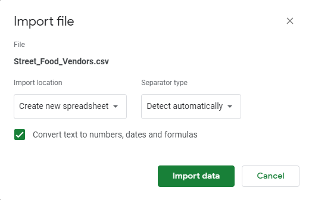
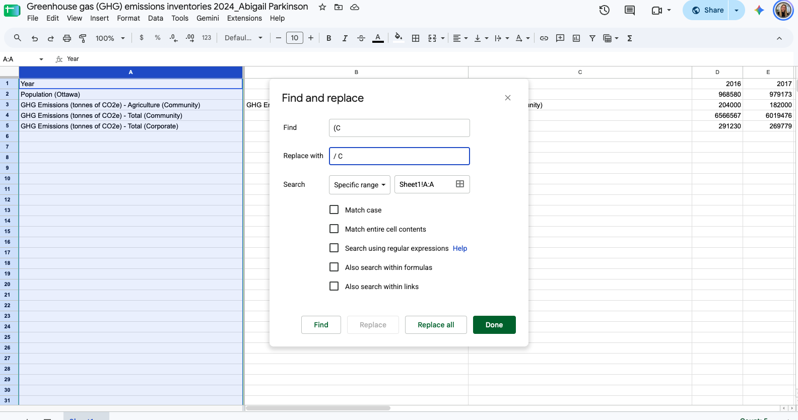
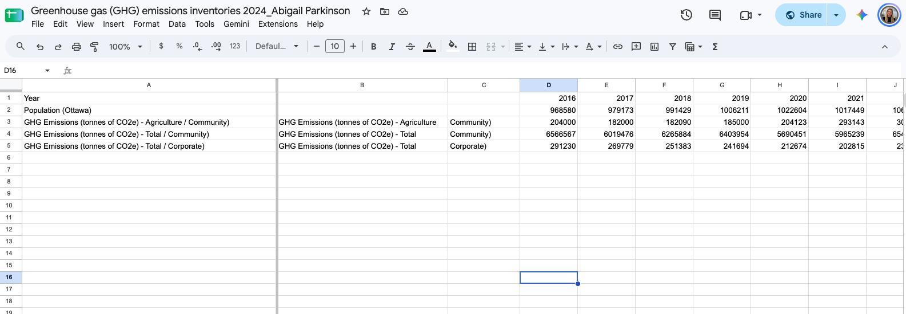
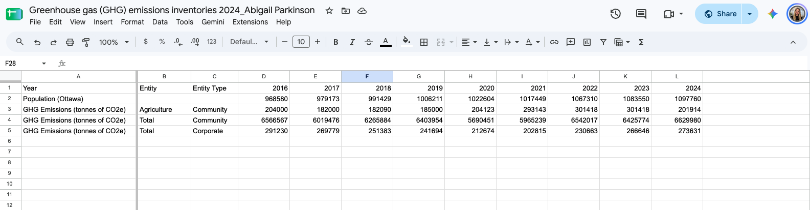
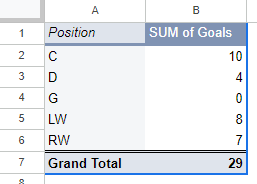
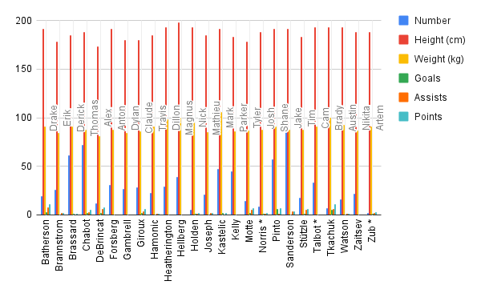

**November 5th 2026**<br>
**Course Code & Course Name**<br>
**Student's First Name & Last Name**<br>
**Presented to Jean-Sébastien Marier**<br>

# Deliverable 2: Exploratory Data Analysis (EDA)

Use one hashtag symbol (`#`) to create a level 1 heading like this one.

## Foreword

For this assignment, you must clean and analyze the dataset from Deliverable 1, create exploratory charts/visualizations, and identify a potential story. Your assignment must clearly detail your process. You are expected to write about 1,000-1,200 words, and to include several screen captures showing the different steps you went through. Your assignment must be written with the Markdown format and submitted on GitHub.

I have been assigning different versions of this project to my digital journalism and data storytelling students for a few years now. Its structure was inspired by the main sections/chapters of [*The Data Journalism Handbook*](https://datajournalism.com/read/handbook/one/). This version was further inspired by the [Key Capabilities in Data Science](https://extendedlearning.ubc.ca/programs/key-capabilities-data-science) program offered by the University of British Columbia (UBC).

**Here are some useful resources for this assignment:**

* [GitHub's *Basic writing and formatting syntax* page](https://docs.github.com/en/get-started/writing-on-github/getting-started-with-writing-and-formatting-on-github/basic-writing-and-formatting-syntax)
* [The template repository for this assignment in case you delete something by mistake](https://github.com/jsmarier/jou4100_jou4500_mpad2003_project2_template)

Did you notice how to create a hyperlink? In Markdown, we put the clickable text between square brackets and the actual URL between parentheses.

And to create an unordered list, we simply put a star (`*`) before each item.

## 1. Getting Data

CONTEXT GOES HERE

The data set I am talking about is one from the Open Ottawa Database about the Greenhouse gas emissions from 2012 to 2024, for this assignment however, I will be looking at the data between years 2016 and 2024.

The original webpage found on the City of Ottawa Dataset can be found at the following link:  https://open.ottawa.ca/datasets/6a4ad31be088433dbcca02b35965cce6/about

However, the table of just the data for the "Greenhouse gas (GHG) emissions inventories 2024" can be found at the following link:  https://open.ottawa.ca/datasets/ottawa::greenhouse-gas-ghg-emissions-inventories-2024/explore 

When I imported the data into my Google Sheets document I used the following steps:
`1.` I first deduced I would need to use the IMPORTDATA function since the City of Ottawa offers a CSV file which would allow me to implicate the IMPORTDATA function.
`2.`  In order to use the IMPORTDATA function I had to figure out the CSV file URL, which I did by using the original webpage found at the City of Ottawa Open Ottawa link, NOT the link to the full table.  At the top of the webpage under the title of the page there is a 'Download' button.  I clicked the 'Download' button which offered the options to download in a CSV, Shapefile, GeoJSON, and KML file format.
`3.`  After that, because there was no CSV URL when I right clicked the 'Download' button for the CSV file I had to click on the 'Download' button and download the CSV file to my Chrome downloads.
`4.`  Then, still in my Chrome browser, I went to the top of the page and clicked on 'Window' and in the drop-down section of 'Window' I clicked 'Downloads'.  This brought me to my Chrome downloads where the CSV file was.
`5.`  I right clicked on the file "Greehouse_gas_(GHG)_emissions_inventories_2024.csv" and selected the option for 'Copy Link Address' which provided me with the proper CSV URL I would need to input into the IMPORTDATA function.
`6.`  After getting the proper CSV URL, I went back into my Google Sheets document and in cell A1 I put in the following function: =IMPORTDATA("https://hub.arcgis.com/api/v3/datasets/6a4ad31be088433dbcca02b35965cce6_0/downloads/data?format=csv&spatialRefId=4326&where=1%3D1")
`7.` The above function properly imported all the data from the City of Ottawa Dataset.
`8.`  After the data was imported I selected everything in the Google Sheets page, copied it, then went to the drop-down 'Edit' tab, selected 'Paste special' and from that drop-down menu selected 'Values only'.  Now the data was ready to work with.

The screenshot of my Google Sheets document after importing the data can be found here:
<br>
*Screenshot of Google Sheets document after importation.*

The public link to my Google Sheets document can be found here: https://docs.google.com/spreadsheets/d/1Jkv3RPNqFqaI8bYbprO5wwSpTM6bdFjy-V2zu7pA7Vk/edit?usp=sharing

Overall, this data appears relatively clean with a total of are 12 rows (the first one being the labels for the columns of data) and 14 columns showing up after I imported the data.  There are a few unnecessary coloums that appeared after importing the data, they are Column L, Column M, and Column N.  Column L and Column M are completely blank except for the words 'column11' in cell 1L and 'column12' in cell 1M.  Column N is labeled in cell 1N as 'ObjectID' with numbers 1 through 11 in cells 2N through 12N.

Column K includes a plethora of nominal variables, a subcategory of categorical variables as they all describe a label or a category that does not have any natural order.  Column K includes a separation between whether the GHG emissions are from corporate production or community production, this is a further type of categorizing the data for ample accuracy.  In Row 2 of the data where the population of Ottawa is given, it is evident that throughout all the years provided, the population was only ever increasing.  To add, the values given for both the population of Ottawa and the GHG emissions throughout the years are discrete numerical values.  A population can not have a series of continuous data as it can not be negative.  Additionally, in terms of the remaining categoricals in Column K, none of the methods of GHG emission (for example, Corporate Facilities, Community Buildings, etc.) create any form of NET carbon removal, therefore also making it discrete variables.

It is interesting to note that at the beginning of each of the years, after I imported the data, the letter 'F' is at the beginning of each of the 'Year' values.  I would hypothesize that this is because when viewing the table on the Open Ottawa website, each of the years has a filter option to arrange the GHG emissions in ascending order, hence the letter 'F' indicating a filter.  Additionally, the years 2013, 2014, 2015 are missing from the data set which is suprising as the years 2016 - 2024 are provided in the dataset.  Due to the missing data, a question that comes to mind as I look at the data table is:  Why does the data offered begin with the Year 2012 and skip the years 2013, 2014, and 2015 and begin again at 2016 and include annual data from 2016 through till 2024?


Use two hashtag symbols (`##`) to create a level 2 heading like this one.

To include a screen capture, use the sample code below. Your images should be saved in the same folder as your `.md` file.

<br>
*Figure 1: The "Import file" prompt on Google Sheets.*

**Here are examples of functions and lines of code put in grey boxes:**

1. If you name a function, put it between "angled" quotation marks like this: `IMPORTHTML`.
1. If you want to include the entire line of code, do the same thing, albeit with your entire code: `=IMPORTHTML("https://en.wikipedia.org/wiki/China"; "table", 5)`.
1. Alternatively, you can put your code in an independent box using the template below:

``` r
=IMPORTHTML("https://en.wikipedia.org/wiki/China"; "table", 5)
```
This also shows how to create an ordered list. Simply put `1.` before each item.

## 2. Understanding Data

### 2.1. VIMO Analysis

Use three hashtag symbols (`###`) to create a level 3 heading like this one. Please follow this template when it comes to level 1 and level 2 headings. However, you can use level 3 headings as you see fit.

    #### Data Source #1: Greenhouse gas (GHG) emissions inventories 2024 - VIMO ANALYSIS
   
    VALID:

    INVALID:  There is no invalid data being shown 
    
    MISSING:  When looking at the data presented, column L and column M have missing information, in the first row of both columns they only include "column11" and "column12", respectively.  In the original data set found online there is also missing information in those columns, originally I expected it to be an issue upon importing the data, however that is not the case.  However, in column N, which is titled ObjectId, and only found in the Google Sheets version of the imported data there is missing ObjectId '2' in Row 4 column N.  My educated hypothesis makes me think that the 'ObjectId' column only appeared upon importing my data to help identify the various row numbering systems of the gas emission values to identify.  Additionally, information that is missing within this dataset is the greenhouse gas emissions for the years 2013, 2014, 2015.  Upon further research it was discovered that 2012 was the first year that Ottawa's greenhouse gas emission data was inventoried and the City of Ottawa had decided that they were only going to report the data every 4 years, hence the missing information from years 2013, 2014, 2015.  However, by 2016, the next available year of data, the City of Ottawa determined they would inventory the greenhouse gas emission data annually, hence the annual data for Years 2016 until 2024.  As this data set includes annual data from 2016 until 2024, this is the range of data I will be looking at.
    
    OUTLIERS:
   


Support your claims by citing relevant sources. Please follow [APA guidelines for in-text citations](https://apastyle.apa.org/style-grammar-guidelines/citations).

**For example:**

As seen in Bounegru & Gray (2011), a data visualization should be clear...

### 2.2. Cleaning Data

Initially, I did some basic Google Sheets data cleaning by deleting the columns deemed unnecessary for my analysis.  This included the blank columns, 'Column L', 'Column M' and 'Column N' which had the 'ObjectID'.  I selected Column L, held my keyboard button 'Shift', and selected Column N which selected the 3 necessary columns and I deleted them.  

Next, I deleted Column A which had all of the various types of GHG emissions for the Year 2012, as I will only be looking at the data from the year 2016 to the year 2024.  I then selected Column K which had the category label for 'Year', 'Population (Ottawa)' and all the categories of GHG Emissions and then copy and pasted the column into the empty Column A and deleted it from Column K, by doing this, the labels became clearer and easier to reflect the information in the rows.  

Following that, I froze Column A so it was easier to horizontally scroll through the information.  I did this by clicking 'A' at the top of the first column, right clicked, and selected the bottom option 'View mor column actions' and then from that drop-down menu, selected, 'Freeze up to column A'.

As mentioned previously, the letter 'F' was placed at the beginning of each year upon importing the data into Google Sheets.  I went through each of the years and deleted the 'F' at the beginning of the respective years.

After that, I decided to delete all the rows I would not need to analyze which resulted in deleting all rows in Column A, except for cell A1, A2, A7, A11, and A12.  Then I moved the rows closer together and shifted them around slightly.  The table looked like this:
<br>
*After Deleting Most of Column A.*

After that, I decided to use the `SPLIT` function on Row 3 to Row 5 to separate 'GHG Emissions (tonnes of CO2e) - Facilities (Corporate)' into Column A having 'GHG Emissions (tonnes of CO2e)', creating a new blank Column B which would have the type of entity, and a new blank Column C which would have whether the entity was 'Corporate' or 'Community'.  To do this I needed to create 2 new columns, which I did by selecting Column A, right clicking, and selecting 'Insert 1 column right, I repeated this process one more time and then had 2 empty columns to the right of Column A.  Then, in order to have a distinct delimiter to use in my `SPLIT` function, I had to go to the 'Edit' tab in Google Sheets and select 'Find and replace' to change the beginning of '(Corporate)' and '(Community)'.

This is the Find and Replace settings I inputted:
 <br>
*Find and Replace Image.*

After this I was able to create a proper function to split the desired categories. Which I did by using the following function in cell B3: `=SPLIT(A3, " / ", FALSE)`.  Then I grabbed the bottom right corner of cell B3 and dragged it down until cell B5.

I ended up with the following image:
<br>
*Unfinished Split.*

The next thing I did to make sure I could properly clean the data further without deleting the original values was to select cells B3, B4, B5, C3, C4, C5, copy the values, and then click 'Paste special' and then 'Values only' into random cells to ensure there was a copy of the values independent of the `SPLIT` function.  Then I copied the values I had pasted in a series of random cells and 'Pasted special', 'Values only' back into Columns B and C so I could edit the values.  After editing the values it resulted in the following:
<br>
*Further Editing of Values.*

This is the final image after cleaning the data set:

<br>
*Final Cleaning of the Data Set.*


### 2.3. Analyzing Data

Insert text here.

**This section should include a screen capture of your pivot table, like so:**

<br>
*Figure 2: This pivot table shows...*

**This section should also include a screen capture of your exploratory chart, like so:**

<br>
*Figure 3: This exploratory chart shows...*

## 3. Delivering Data

Insert text here.

## 4. References

Include a list of your references here. Please follow [APA](https://apastyle.apa.org/style-grammar-guidelines/references) or [MLA](https://www.mla.org/MLA-Style) guidelines for references. Hanging paragraphs aren't required though.

Reference: https://ottawa.ca/en/living-ottawa/environment-conservation-and-climate/reducing-greenhouse-gas-emissions/greenhouse-gas-emissions-dashboard/dashboard

https://support.google.com/docs/answer/3093335?sjid=15167303642615850670-NA


**Here's an example:**

Bounegru, L., & Gray, J. (Eds.). (2021). *The Data Journalism Handbook 2: Towards A Critical Data Practice*. Amsterdam University Press. [https://ocul-crl.primo.exlibrisgroup.com/permalink/01OCUL_CRL/hgdufh/alma991022890087305153](https://ocul-crl.primo.exlibrisgroup.com/permalink/01OCUL_CRL/hgdufh/alma991022890087305153)
