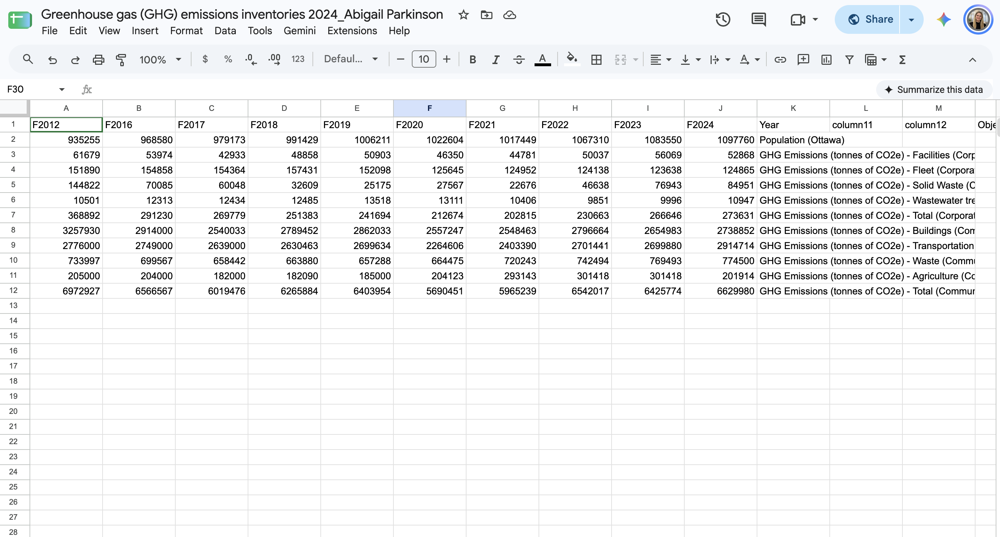
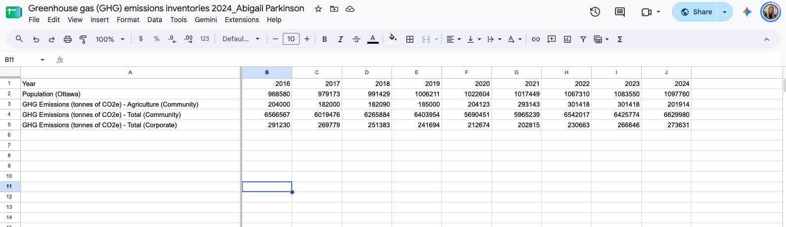
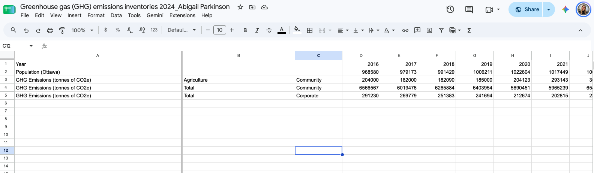

**November 16th 2026**<br>
**MPAD2003A Introductory Data Storytelling**<br>
**Abigail (Piper) Parkinson**<br>
**Presented to Jean-Sébastien Marier**<br>

# Deliverable 2: Exploratory Data Analysis (EDA)

## 1. Getting Data

**Context**

This data set from the [*Open Ottawa*] website is looking at the GHG emission levels, or, the tonnes of CO<sub>2</sub>e produced by various community and corporate entities within the city of Ottawa from the years 2012 to 2024.  The scope of the final project includes an analysis of the negative impacts of greenhouse gases and climate on agricultural grain for growth in Ottawa.  This data set includes much required information on this topic as it shows solid data, specifically for the GHG emissions produced by community agricultural entities in Ottawa which can be held in perspective to the total community and corporate GHG emissions.  In the final product, these will also be analyzed in relation to the population of Ottawa found in the same data set and by looking at the other data sets mentioned in my Story Pitch & Preliminary Research portion of this project.  The aforementioned data sets explain the impact of greenhouse gases in relation to the growth of crops and corn growth within the time frame of 2016 - 2024.

**Links**

The original webpage found on the [*Open Ottawa Database*] can be found at the following link:  (https://open.ottawa.ca/datasets/6a4ad31be088433dbcca02b35965cce6/about).

<ins>Just</ins> the data for the [*Greenhouse gas (GHG) emissions inventories 2024*] can be found at the following link:  (https://open.ottawa.ca/datasets/ottawa::greenhouse-gas-ghg-emissions-inventories-2024/explore).

The public link to my Google Sheets document can be found here: (https://docs.google.com/spreadsheets/d/1Jkv3RPNqFqaI8bYbprO5wwSpTM6bdFjy-V2zu7pA7Vk/edit?usp=sharing).

**Google Sheets Data Importation Steps**

`1.` First, I deduced that I would need to use the `IMPORTDATA` function as there was an available CSV file for the data set.
`2.`  In order to use the `IMPORTDATA` function I had to find the CSV file URL, as I was unable to find it by right-clicking the `Download CSV` button.  I accessed the CSV URL by using the original webpage found at the [*Open Ottawa Database*] website, <ins>NOT</ins> the website to the full table.  At the top of the webpage under the title of the page there is a `Download` button.  Then, I clicked the `Download CSV` button to download the CSV file to my Chrome downloads.
`4.`  Then, still in my Chrome browser, I went to the top of the page and clicked on `Window` and in the drop-down section, I clicked `Downloads`.  This brought me to my Chrome downloads where the CSV file was.
`5.`  I right clicked on the file `Greehouse_gas_(GHG)_emissions_inventories_2024.csv` and selected the option for `Copy Link Address` which provided me with the proper CSV URL I would need to input into the `IMPORTDATA` function.
`6.`  After getting the proper CSV URL, I went back into my Google Sheets document and in cell A1 I put in the following function: 
``` =IMPORTDATA("https://hub.arcgis.com/api/v3/datasets/6a4ad31be088433dbcca02b35965cce6_0/downloads/data?format=csv&spatialRefId=4326&where=1%3D1") ```
`7.` The above function properly imported all the data from the [*Open Ottawa Database*] website.
`8.`  After the data was imported I selected everything in the Google Sheets page, copied it, then went to the drop-down `Edit` tab, selected `Paste special` and from that drop-down menu selected `Values only`.  Now the data was ready to work with.

The screenshot of my Google Sheets document after importing the data can be found here:
<br>
*Figure 1: Screenshot of Google Sheets document after importation.*

**General Analysis of the Data**

Overall, this data appears relatively clean with a total of 12 rows (the first being labels) and 14 columns showing up after I imported the data, however, `Column L`, `M`, and `N` appeared unnecessary.  `Column L` and `Column M` are blank except for the words `column11` in cell `1L` and the words `column12` in cell `1M`.  `Column N` is labeled in cell `1N` as `ObjectID` with numbers 1 through 11 in cells `2N` through `12N`.

`Column K` includes a plethora of nominal variables, a subcategory of categorical variables as they all describe a label or a category that does not have any natural order.  `Column K` includes data regarding unit of measurement of GHG emissions, in  tonnes of CO<sub>2</sub>e, whether they are from corporate or community entities.  The aforementioned is a further type of categorization of data for ample accuracy.  In `Row 2` of the data, illustrating the population of Ottawa, it is evident that the population was only ever increasing.  To add, the values given for both the `Population` of Ottawa and the `GHG Emissions` throughout the years are discrete numerical values.  A population can not have a series of continuous data as it can not be negative.  Additionally, in terms of the remaining categoricals in `Column K`, none of the methods of GHG emission (for example, Corporate Facilities, Community Buildings, etc.) create any form of NET carbon removal, therefore also making it discrete variables.

It is interesting to note that at the beginning of each of the years, after I imported the data, the letter `F` is at the beginning of each of the `Year` values.  I would hypothesize that this is because when viewing the table on the [*Open Ottawa Database*] website, each of the years has a filter option to arrange the `GHG Emissions` in ascending order, hence the letter `F`, indicating a filter.  Additionally, the years 2013, 2014, 2015 are missing from the data set which is surprising as the years 2012, and 2016 through to 2024 are provided in the dataset.  Due to the missing data, a question that comes to mind is, why does the data offered begin with the `Year 2012` and skip the years 2013, 2014, and 2015 and begin again at 2016 and include annual data from 2016 through to 2024?

## 2. Understanding Data

### 2.1. VIMO Analysis on [*Greenhouse gas (GHG) emissions inventories 2024*] Data Set
   
<ins>VALID</ins>:  No data appears to be missing from this data set.  The only data "not found" is in `Column L` and `Column M` which presents no data, indicating an issue with the text alignment post-importation, not a lack of validity in the data.  Additionally, as mentioned that the data includes discrete varaibles, all of the data offered is within a valid range.

<ins>INVALID</ins>:  `Column L` and `Column M`, which show columns of blank data are invalid as they show no data, these columns simply need to be deleted once I begin cleaning the data.  There are no invalid outlier variables, all of the data given expresses accuract and reasonable data within the scope of the given categories.
    
<ins>MISSING</ins>:  When looking at the data presented, `Column L` and `Column M` have missing information, in the first row of both columns they only include the words `column11` and `column12`, respectively.  In the original data set found online there is also missing information in those columns, however because the labeling of the unit of measurement, entity, and type of entity are all included in a singular column cell, it is assumed that because of the formatting of the website and the length of the label, these columns were just incorrectly included in the table.  `Column N` is titled `ObjectId`, my educated hypothesis is that the `ObjectId` column only appeared upon importing my data to help identify the various row numbering systems of the gas emission values to identify.  Additionally, information that is missing within this dataset is the greenhouse gas emissions for the years 2013, 2014, 2015.  Upon further research it was discovered that 2012 was the first year that Ottawa's greenhouse gas emission data was inventoried and the city of Ottawa had decided that they were only going to report the data every 4 years, hence the missing information from years 2013, 2014, 2015.  By 2016, the next available year of data, the city of Ottawa determined they would inventory the greenhouse gas emission data annually, hence the annual data for Years 2016 to 2024.  As this data set includes annual data from 2016 until 2024, and also aligns with other data sets I am using, this is the range of data I will be analysing.
    
<ins>OUTLIERS</ins>:  In terms of the labeling of the data, none of the values appear to be outliers in this set, however, the largest values in this data set are found in the tonnes of CO<sub>2</sub>e produced by community buildings, community transportation, and naturally, the community total of CO<sub>2</sub>e emissions.  The smallest values were found in the tonnes of CO<sub>2</sub>e produced by corporate facilities and corporate wastewater treatments.
   
### 2.2. Cleaning Data

Initially, I did some basic Google Sheets data cleaning by deleting the columns deemed unnecessary for my analysis.  This included the blank columns, `Column L`, `Column M` and `Column N` which had the `ObjectID` label.  I selected `Column L`, held my keyboard button `Shift`, and selected `Column N` which selected the 3 necessary columns and I deleted them.  

Next, I deleted `Column A` which had all of the various types of GHG emissions for the Year 2012, as I will only be looking at the data from the year 2016 to the year 2024.  I then selected `Column K` which had the category label for `Year`, `Population (Ottawa)` and all the categories of GHG Emissions and then copy and pasted the column into the empty `Column A` and deleted it from `Column K`, by doing this, the labels became clearer and easier to reflect the information in the rows.  

Following that, I froze `Column A` so it was easier to horizontally scroll through the information.  I did this by clicking `A` at the top of the first column, right-clicked, and selected the bottom option `View more column actions` and then from that drop-down menu, selected, `Freeze up to column A`.

As mentioned previously, the letter `F` was placed at the beginning of each year upon importing the data into Google Sheets.  I went through each of the years and deleted the `F` at the beginning of the respective years.

After that, I decided to delete all the rows I would not need to analyze which resulted in deleting all rows in `Column A`, except for cell `A1`, `A2`, `A7`, `A11`, and `A12`.  Then I moved the rows closer together and shifted them around slightly.  The table looked like this:
<br>
*After Deleting Most of Column A.*

After that, I decided to use the `SPLIT` function on `Row 3` to `Row 5` to separate `GHG Emissions (tonnes of CO2e) - Facilities (Corporate)` into `Column A` being `GHG Emissions (tonnes of CO2e)`, a new blank `Column B` which would have the type of entity, and a new blank `Column C` which would have whether the entity was `Corporate` or `Community`.  To do this I needed to create 2 new columns, which I did by selecting `Column A`, right-clicking, and selecting `Insert 1 column right`, I repeated this process one more time and then had 2 empty columns to the right of `Column A`.  Then, in order to have a distinct delimiter to use in my `SPLIT` function, I had to go to the `Edit` tab in Google Sheets and select `Find and replace` to change the beginning of `(Corporate)` and `(Community)`.

This is the Find and Replace settings I inputted:
 <br>
*Find and Replace Image.*

After this I was able to create a proper function to split the desired categories. Which I did by using the following function in cell B3: ```=SPLIT(A3, " / ", FALSE)```.  Then I grabbed the bottom right corner of cell `B3` and dragged it down until cell `B5`.

I ended up with the following image:
<br>
*Unfinished Split.*

The next thing I did to make sure I could properly clean the data further without deleting the original values was to select cells `B3`, `B4`, `B5`, `C3`, `C4`, `C5`, copy the values, and then click `Paste special` and then `Values only` into random cells to ensure there was a copy of the values independent of the `SPLIT` function.  Then I copied the values I had pasted in a series of random cells and `Pasted special`, `Values only` back into `Columns B` and `C` so I could edit the values.  

After editing the values it resulted in the following:
<br>
*Further Editing of Values.*

This is the final image after cleaning the data set:

<br>
*Final Cleaning of the Data Set.*

### 2.3. Analyzing Data

I created a pivot table, I did this by selecting all of the data, selecting `Insert` from the Google Sheets menu, and selecting `Pivot table`, I created a new sheet.

## 3. Delivering Data

Insert text here.

## 4. References

References

City of Ottawa. (2026, April). Greenhouse gas emissions dashboard. City of ottawa. https://ottawa.ca/en/living-ottawa/environment-conservation-and-climate/reducing-greenhouse-gas-emissions/greenhouse-gas-emissions-dashboard/dashboard 

Google. (n.d.-a). Importdata. Google Docs Editors Help. https://support.google.com/docs/answer/3093335?sjid=15167303642615850670-NA 

Google. (n.d.-b). Split function. Google Docs Editors Help. https://support.google.com/docs/answer/3094136?sjid=10380514238157516166-NA 

Greenhouse Gas (GHG) emissions inventories 2024. Open Ottawa. (2025, October 15). https://open.ottawa.ca/datasets/ottawa::greenhouse-gas-ghg-emissions-inventories-2024/explore 

*Use of https://www.citationmachine.net to create my APA 7 citations


